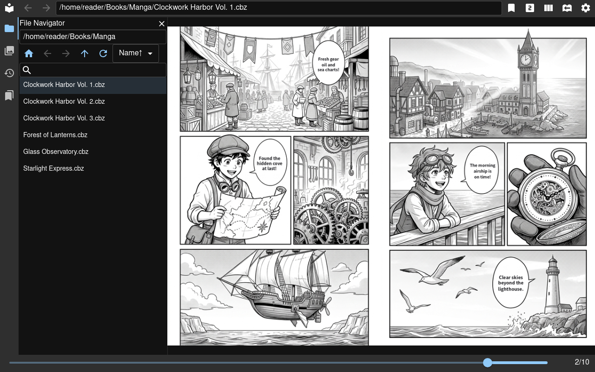
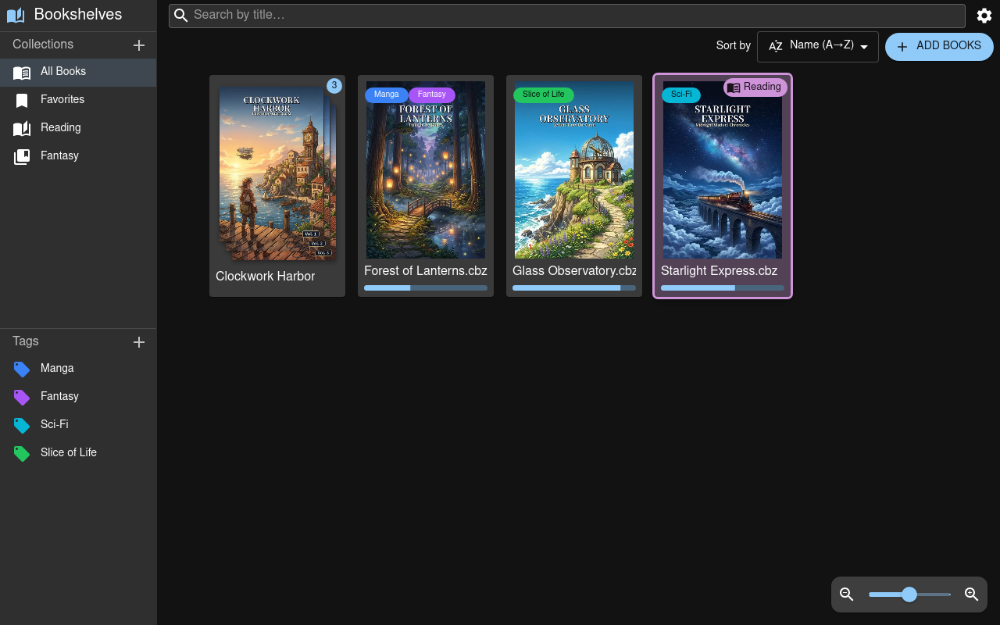

# RookReader

[](https://github.com/Rookro/RookReader/releases/latest)
[](https://github.com/Rookro/RookReader/actions/workflows/build-app-actions.yml)
[](https://github.com/Rookro/RookReader/actions/workflows/full-validation.yml)
[](LICENSE)
[](https://v2.tauri.app/)
[](https://mui.com/material-ui/)
[](https://react.dev/)
[](https://www.typescriptlang.org/)
[](https://rust-lang.org/)

[English](README.md) | [日本語](docs/ja_JP/README.md) · [User Guide](https://github.com/Rookro/RookReader/wiki/User-Guide) | [FAQ](https://github.com/Rookro/RookReader/wiki/FAQ-&-Troubleshooting) | [Developer Guide](https://github.com/Rookro/RookReader/wiki/Developer-Guide) | [Changelog](CHANGELOG.md)

RookReader is a fast, modern, cross-platform desktop e-book and comic reader for **Windows** and **Linux**. Built around Japanese vertical writing and right-to-left reading, it opens comic archives, image folders, PDFs, and EPUBs directly while keeping your library organized on a visual bookshelf.



## Features

- **Wide format support:** `zip`, `cbz`, `rar`, `cbr` (including folders inside archives), image directories, `pdf`, and `epub` *(experimental novel reader)*. Supports `png` / `apng`, `jpeg`, `gif`, `webp`, and `avif` page images.
- **Built for Japanese comics & novels:** Right-to-left binding by default, with a per-book reading direction toggle for left-to-right titles.
- **Comfortable page display:** Two-page spread view (with cover detection and spread pairing shift) and a high-detail magnifier (loupe) for small text and artwork.
- **Continuous reading & resume:** Automatically open the next or previous volume at book boundaries, save named bookmarks, and resume from your reading history.
- **Bookshelf organization:** Organize books into custom collections with icons, group volumes into ordered series, filter with colored tags, and search or sort your library.
- **Fast & native:** Powered by a Rust + Tauri backend with background page preloading and sharp downscaling to avoid moiré.
- **Polished desktop UX:** Light and Dark themes, English and Japanese UI, keyboard-friendly navigation, and built-in update checks.

## Installation

Pre-built binaries are available on the [GitHub Releases](https://github.com/Rookro/RookReader/releases/latest) page. Download the package for your platform:

### Windows

| File | Installation |
| :--- | :--- |
| `RookReader_x.x.x_x64-setup.exe` | Download and run the installer. |

### Linux

| Distribution | Package | Installation |
| :--- | :--- | :--- |
| Debian / Ubuntu / Mint | `RookReader_x.x.x_amd64.deb` | Double-click or run `sudo dpkg -i <filename>`. |
| Fedora / RHEL / openSUSE | `RookReader_x.x.x-x.x86_64.rpm` | Run `sudo dnf install <filename>` (or `sudo yum install <filename>`). |
| Arch Linux / Manjaro | `PKGBUILD` | See [Arch Linux Instructions](#arch-linux-instructions) below. |
| Other distributions (Universal) | `RookReader_x.x.x_amd64.AppImage` | Run `chmod +x <filename>` and execute it directly. |

#### Arch Linux Instructions

1. Download `PKGBUILD` from the `PKGBUILD/` directory of this repository.
2. In the directory containing it, build and install the package:

   ```bash
   makepkg -si
   ```

> Having trouble launching on Linux (for example, WebKit2GTK dependencies or a blank AppImage window on Wayland)? See [FAQ & Troubleshooting](https://github.com/Rookro/RookReader/wiki/FAQ-&-Troubleshooting).

## Quick Start

- **Open a book:** Click an archive, PDF, EPUB, or image folder in the left **File Navigator**, or drag and drop it onto the window.
- **Turn pages:** Click (next) / right-click (previous), scroll the mouse wheel, or use the arrow keys and `Space`.
- **Manage your library:** Switch to the **Bookshelf** from the top-left button to organize collections, series, and tags, or drop files directly onto the bookshelf to add them.



> For the full list of keyboard shortcuts, two-page spread controls, magnifier (loupe), continuous reading, bookmarks, and all settings, see the **[User Guide](https://github.com/Rookro/RookReader/wiki/User-Guide)** on the Wiki.

## Documentation & Contributing

- **[User Guide](https://github.com/Rookro/RookReader/wiki/User-Guide)** — detailed usage, keyboard & mouse controls, bookshelf/series management, and settings reference.
- **[FAQ & Troubleshooting](https://github.com/Rookro/RookReader/wiki/FAQ-&-Troubleshooting)** — data and log locations, settings recovery, and Linux tips.
- **[Developer Guide](https://github.com/Rookro/RookReader/wiki/Developer-Guide)** — architecture overview, DevContainer & native setup, `sqlx` migrations, and testing.
- **[Contributing Guide](CONTRIBUTING.md)** — Git Flow branching model, coding conventions, and pre-PR checks.
- **[Changelog](CHANGELOG.md)** — release notes and recent changes.

Bug reports and feature suggestions are welcome via [GitHub Issues](https://github.com/Rookro/RookReader/issues), and code contributions via Pull Requests.

## License

This project is licensed under the [MIT License](LICENSE).
